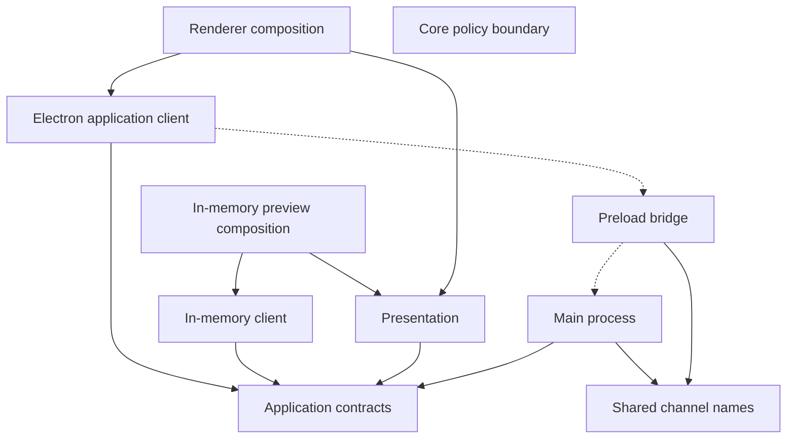

# 0001 — Electron, React, and Vite scaffold

## Context

The repository started as a bare Electron package. `package.json` named `index.ts` as the main entry, `npm start` ran `electron .`, and that entry only logged a message. There was no compile step, so Electron could not load the application. npm and `package-lock.json` were already the package manager. Electron 45.1.0 was already selected. The only documentation file was `README.md`, so this decision record lives in `docs/decisions/`.

WURST-13 asks for a working desktop scaffold with clear boundaries. It does not ask for planning integrations, persistence, agents, an editor, or release infrastructure.

## Decision

Keep one npm workspace. The root package remains the Electron application and stays CommonJS so electron-vite emits CommonJS main and preload bundles. Add three private packages:

- `@wurst/core` has no dependencies and exports only an explicit marker that engineering policy is unspecified.
- `@wurst/application` owns the client contract, the fixture messages, their runtime parsers, and the in-memory client.
- `@wurst/presentation` is React and depends only on the application contract plus React.

The Electron host lives in `src/main`, `src/preload`, and `src/renderer`. A second composition root in `src/preview` renders the same presentation with `createInMemoryApplicationClient`. Concrete clients are created only in those composition roots and in tests.

electron-vite builds the three processes into separate `out/main`, `out/preload`, and `out/renderer` directories. electron-builder packages the current OS as an unpacked directory. The builder file list ships `out/` and `package.json` only.

The renderer is created with context isolation, a sandboxed preload, web security, and Node integration disabled for the page and its frames. The preload exposes one `window.wurst` object with a workspace query and a host-status subscription. The main process rejects unexpected query payloads and ignores subscription messages that carry a payload. Overview and status values are parsed before they are trusted.

The visible workspace is labeled fixture content. Its three areas are intent and planning, development and validation, and deliverables. A one-second host-status sequence demonstrates the subscription. Unsubscribing the last listener stops the timer.

## Rationale

The existing `electron .` script could not grow into a typed React app without a build, and replacing the repository would have discarded the chosen runtime and lockfile. electron-vite already separates main, preload, and renderer, and electron-builder is the packaging tool that matches that setup. `@electron-toolkit/preload` was not used because its shared Electron API is a general IPC facade; this scaffold exposes two operations instead.

Application parsers live beside the contract so the host and the in-memory client validate the same message shape. The privileged check still runs in the main process before a message is sent, and the renderer client parses again before React sees it. TypeScript types are not treated as the boundary.

Core has no inbound dependency. Inventing workflow rules for the scaffold would look like product behavior that does not exist. The package is there so later policy can land without pulling Electron or React downward.

electron-vite 6 does not list Electron 45 in its Node and Chrome target table, and the fallback is an old pair. The Vite config pins `node24.22` and `chrome156`, which are the versions reported by Electron 45.1.0 (`process.versions.node` 24.22.1 and Chrome 156.0.8078.49).

## Dependency direction

Solid arrows are compile-time dependencies. Dotted arrows are the runtime bridge. `@wurst/core` has no edges yet.

## Consequences

A clean checkout can install from the lockfile, type-check, test, open the Electron app, open the browser preview, build, and package an unpacked Linux app. Presentation and core tests do not launch Electron. The packaged app reads the built renderer file.

The root package is `private` because npm workspaces require it. The app is distributed as an Electron package, not as an npm library.

## Limitations

- The workspace data is a fixture. Nothing talks to Jira, Git, a model provider, or a verification runner.
- Core policy is intentionally absent.
- Packaging was exercised for the unpacked Linux x64 directory target only. macOS, Windows, AppImage, deb, installers, signing, and notarization were not run.
- There is no GitHub Actions workflow. WURST-14 owns CI and the broader quality gates.
- This host launched Electron without Chromium's `--no-sandbox` flag. A more restricted container may still need that process flag. The window keeps `webPreferences.sandbox: true` either way.

## Verification

On this Linux x64 host, using the lockfile in this change:

- `npm ci` installed the workspace.
- `npm run typecheck` completed with no errors after that install.
- `npm test` passed 30 tests after that install.
- `npm run dev` opened Electron against the Vite renderer at `http://localhost:5173/`. The page showed the fixture areas, the Electron preload bridge, and an increasing host-status sequence. Closing Electron made `electron-vite` exit and port 5173 close.
- `npm run dev:ui` served the same presentation at `http://localhost:5174/` with the label "in-memory client" and a live status sequence. No Electron process was required.
- `npm run package` produced `release/linux-unpacked/wurst`. The asar contains only `out/` and `package.json`. The app loaded `file://…/app.asar/out/renderer/index.html`, showed the fixture workspace through the Electron bridge, and a direct bridge subscription stopped receiving events after unsubscribe. The renderer process was started with `--enable-sandbox`.
- macOS, Windows, and installer targets were not built.
